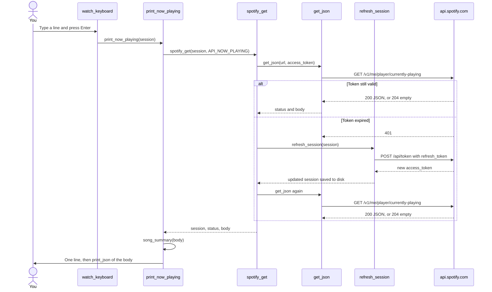
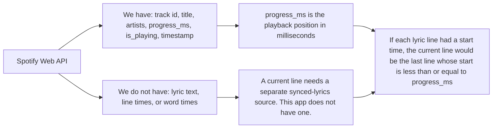

# How this terminal talks to Spotify

`connect_spotify.py` only talks to URLs listed in Spotify's Web API reference. The reference is the OpenAPI file linked from [Spotify for Developers](https://developer.spotify.com/documentation/web-api). A URL is used when that document says the endpoint returns the thing we asked for, and when one of our scopes allows it.

Lyrics are not in that document. No scope unlocks them. The graphs below stop at the song and the playback position, which is as far as these URLs go.

## Which URL answers which question

```mermaid
flowchart TD
    ask["Question: what do we need?"] --> docs["Look up the Web API reference"]
    docs --> found{"An endpoint lists that field?"}
    found -->|No| missing["Official API cannot return it. Lyrics and the current lyric line are in this group."]
    found -->|Yes| scope{"Do our scopes allow it?"}
    scope -->|No| denied["Spotify returns 403 until the user approves that scope"]
    scope -->|Yes| call["spotify_get sends GET to that URL with the saved access token"]

    call --> me["GET /v1/me"]
    call --> now["GET /v1/me/player/currently-playing"]
    call --> player["GET /v1/me/player"]
    call --> devices["GET /v1/me/player/devices"]
    call --> queue["GET /v1/me/player/queue"]

    me --> meFields["Account: display_name, id, email, product"]
    now --> nowFields["Song: item.name, item.artists, item.id, progress_ms, is_playing"]
    player --> playerFields["Same playback fields, plus the active device. Not called yet."]
    devices --> deviceFields["List of speakers and computers. Not called yet."]
    queue --> queueFields["Upcoming tracks. Not called yet."]
```

The two calls the script makes today:

| Question | Function | URL constant | Why this URL |
| --- | --- | --- | --- |
| Who logged in? | `print_profile` | `API_ME` = `https://api.spotify.com/v1/me` | The profile reference says this returns the current user. Scopes: `user-read-private`, `user-read-email`. |
| What song is playing, and how far into it? | `print_now_playing` | `API_NOW_PLAYING` = `https://api.spotify.com/v1/me/player/currently-playing` | The player reference says this returns the current item and `progress_ms`. Scope: `user-read-currently-playing`. |

Login uses two more URLs, because the Web API will not answer until Spotify has issued a token:

| Step | Function | URL constant |
| --- | --- | --- |
| Send the browser to Spotify's approval page | `authorize` | `AUTH_URL` = `https://accounts.spotify.com/authorize` |
| Trade the one-time code, or a refresh token, for an access token | `post_form` | `TOKEN_URL` = `https://accounts.spotify.com/api/token` |

## What happens when you run the file

```mermaid
flowchart TD
    start["python connect_spotify.py"] --> main["main"]
    main --> load["load_saved_session"]
    load --> file{"`.spotify/tokens.json` has client_id and access_token?"}

    file -->|Yes| profile
    file -->|No| setup["print_setup"]
    setup --> askId["prompt: Client ID"]
    askId --> auth["authorize"]

    auth --> pkce["generate_pkce"]
    pkce --> browser["Browser opens AUTH_URL"]
    browser --> spotifyLogin["You approve the app on Spotify"]
    spotifyLogin --> callback["Local page REDIRECT_URI receives code and state"]
    callback --> handler["Handler.do_GET fills CallbackResult"]
    handler --> token["post_form to TOKEN_URL"]
    token --> save["save_tokens writes `.spotify/tokens.json`"]
    save --> summary["print_token_summary"]
    summary --> profile

    profile["print_profile"] --> getMe["spotify_get API_ME"]
    getMe --> showMe["print_json of the profile"]
    showMe --> firstSong["print_now_playing"]
    firstSong --> loop["watch_keyboard"]

    loop --> typed{"Line you typed"}
    typed -->|q, quit, or exit| stop["Function returns"]
    typed -->|Anything else, including Enter| again["print_now_playing"]
    again --> loop
```

## One song check, from keypress to JSON

`print_now_playing` does not choose a URL itself. It passes `API_NOW_PLAYING` to `spotify_get`. `spotify_get` attaches the access token and retries once if Spotify says the token expired.



`song_summary` only reads `item.name`, `item.artists[].name`, or `item.show.name`. It does not call Spotify. `print_json` prints the whole body and does not call Spotify either.

## Where a lyric line would have to come from



`progress_ms` updates only when the script asks again. Between keypresses, a playing song moves forward, but this program does not estimate that movement. `timestamp` is when Spotify last reported the state, and `is_playing` says whether it was moving then.
